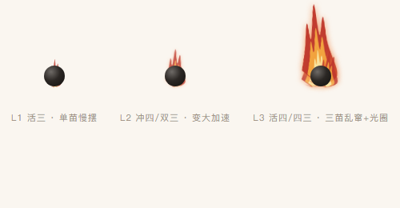

# 双弈 · 只有你们两个人的五子棋

一个房间制的双人五子棋小程序：没有匹配、没有广告、没有排行榜，只有两个人的棋盘。

| 首页 | 对局 | 结算 |
| --- | --- | --- |
|  |  |  |

> `design/` 里是按 WXSS 参数 1:1 还原的静态预览图，用于确认版式，不参与编译。

火势效果（L3：活四 / 四三，静态预览）：



## 已实现

- 创建房间（4 位房间号，自动复用未结束的房间，不会堆一堆空房）
- 输入房间号 / 分享卡片进入，房主不用手动同意
- 15×15 标准棋盘，五子连珠判定、和棋判定、认输
- 双方同意后重开一局，并自动交换先后手；房间号不变，可以连着下一晚
- 悔棋：只能撤回自己刚下的一手，需要对方同意；请求后对方直接落子则请求自动作废
- 落子确认：点空位先出现半透明预览，底部换成「✕ 重选 / ✓ 落子」；换点直接移动预览，确认前不提交
- 火势：三层扁平火团从**棋子背后**升起——谁的棋子着火，谁就是快赢的一方
  - **火长在棋子上**：黑方威胁 → 黑棋着火；白方威胁 → 白棋着火；双方都有 → 两颗都烧
  - 三档强度：L1 活三 = 一簇小火苗；L2 冲四/双活三 = 大一号、跳得快；L3 活四/四三 = 三簇火苗 + 暖光圈 + 急促乱跳；威胁被堵死即熄灭
  - 判定用「假设落子法」，覆盖跳三、跳四、双活三、四三，不参与胜负
  - 火势开关放在底部「火势」按钮，改动需要对方同意（请求 → 同意/拒绝），状态存在房间上
- 码字：点「码字」在棋盘下方展开 24 字字盘，拼句发送；一句话最多 50 字
  - 字盘打开时棋盘位置不变，仍然可以正常落子
  - 双方各有一条独立消息位，各显示 3 秒，互不覆盖
  - 支持回退、清除；发送后面板不收起，点「码字」才收起
- 指路：长按任意空点，对方棋盘上闪一圈涟漪——只有暗示，不落子
- 一局结束后的 30 分钟内，房间还能从首页「刚刚那局」回去，不用重新开房
- 落子后实时同步（云数据库 `watch` 推送，失败自动降级为轮询）
- 断线重进 / 切后台回来可恢复对局
- 落子、轮次、胜负全部由云函数校验，前端只做展示

## 跑起来（6 步）

1. 用微信开发者工具「导入项目」，目录选本仓库根目录。
2. 把 `project.config.json` 里的 `appid` 换成你自己的小程序 AppID（不能用测试号，测试号没有云开发）。
3. 开通云开发：工具栏**左侧**点「云开发」，按提示开通，记下环境 ID。
   - 新版工具如果找不到入口，可直接登录 mp.weixin.qq.com 小程序后台 → 开发 → 云开发
   - 如果账号下只有一个环境，`miniprogram/app.js` 里的 `CLOUD_ENV` 留空即可。
   - 有多个环境时，把环境 ID 填进 `CLOUD_ENV`。
4. 数据库集合 `rooms` 会在首次运行时由云函数**自动创建**，不需要手动建表。
   - 想让对方落子秒同步：云开发控制台 → 数据库 → `rooms` → 权限设为「所有用户可读，仅创建者可写」
   - 不改也能玩：实时监听会失败并自动降级成 2.5 秒轮询，只是对方落子慢半拍
5. 右键 `cloudfunctions/gomoku` → **上传并部署：云端安装依赖**。
6. 编译运行。测试时建议用「多账号调试」或一台真机 + 一个模拟器：
   一方创建房间拿到 4 位号码，另一方输入号码进入。

## 目录

```
miniprogram/
  app.js                 云开发初始化 + 获取匿名身份
  utils/cloud.js         云函数调用封装、错误文案归一
  pages/index/           首页：创建 / 加入 / 继续对局
  pages/game/            对局页：棋盘、实时同步、结果弹层
cloudfunctions/gomoku/   唯一的云函数，action 分发
```

## 云函数动作

| action | 作用 | 关键防错 |
| --- | --- | --- |
| `whoami` | 返回当前用户在本产品内的匿名 uid | openid 经 SHA256 截断，不落库明文 |
| `create` | 建房 / 复用未结束房间 | 12 小时过期自动关闭 |
| `join` | 按房间号加入 | `where(playerCount=1)` 条件更新，杜绝两人同时挤进同一间房 |
| `get` | 恢复对局 | 支持 roomId 或 房间号 |
| `place` | 落子 | 校验轮次 + `moveCount` 乐观锁；不用 `version`，否则对方发消息也会把你的落子顶掉 |
| `rematch` | 再来一局 | 双方都同意才重置，交换先后手 |
| `requestUndo` | 请求悔棋 | 只有「刚下完、还没轮到对方」的人能发起；`version` 锁拒绝并发 |
| `respondUndo` | 同意 / 拒绝悔棋 | 同意时校验 `lastMove` 与棋谱末位一致，避免撤回错子 |
| `cancelUndo` | 撤回自己的悔棋请求 | 只有发起人可取消 |
| `sendSentence` | 发一句拼出来的话 | 只允许 24 字盘里的字 + 最多 50 字 + 1 秒冷却，按颜色写入各自消息位 |
| `sendHint` | 长按指路 | 只能指空点 + 1200ms 冷却，不改变棋局 |
| `requestFire` | 请求开关火势 | 需对方同意；同一时间只允许一个待处理请求 |
| `respondFire` | 同意 / 拒绝火势开关 | 同意后写入 `fireEnabled`，请求清空 |
| `resign` / `leave` | 认输 / 取消空房 | 只允许等待中的房间被关闭 |

## 数据（rooms 集合）

```js
{
  code: '8362',
  status: 'waiting' | 'playing' | 'finished' | 'closed',
  board: number[225],        // 0 空 / 1 黑 / 2 白，索引 = y * 15 + x
  history: [{ x, y, color }], // 棋谱，用于悔棋与后续复盘
  undoRequest: null | { by: uid, color, at },
  sentenceBlack: null | { text, by, at },  // 黑方当前这句，客户端只显示 3 秒内的
  sentenceWhite: null | { text, by, at },  // 白方独立一份，双方互不覆盖
  fireEnabled: true,                        // 火势动画开关（需双方同意）
  fireRequest: null | { by: uid, value, at },
  hint: null | { x, y, by: uid, color, at },   // 指路涟漪
  turn: 'black' | 'white',
  winner: 'black' | 'white' | 'draw',
  winLine: number[],         // 用于高亮连成五子的棋子
  players: [{ color: 'black' }, { color: 'white' }],
  playerIds: [uid],
  playerCount: 1,
  rematchIds: [uid],
  version: 0,                // 每次写入 +1，客户端据此去重
  round: 1,
  lastMove: { x, y, color },
  createdAt, updatedAt
}
```

## 刻意没做的

- 开放匹配、观战、聊天、排行榜：会引入陌生人，违背"只有你们"的前提。
- 一次撤两步的悔棋：会让"悔棋"变成"看穿对方应手后再改主意"，只保留撤回自己刚下的一手。
- AI 对手：和情侣对局的定位冲突，后续可作为"等人时自己练棋"的独立入口。

## 声音

素材全部为代码合成的原创音频（`design/gen-audio.py` 生成，无版权风险），放在 `miniprogram/assets/audio/`，共约 274KB：

| 文件 | 用途 | 时长 |
| --- | --- | --- |
| `bgm.mp3` | 背景音乐：原神「璃月 Liyue」截取的 39 秒无缝循环，96kbps | 39s |
| `place.mp3` | 自己落子：木质清脆一击 | 0.2s |
| `place_op.mp3` | 对方落子：音高更低更轻，和自己的落子区分 | 0.2s |
| `tap.mp3` | 按钮点击、棋盘预览选中 | 0.09s |
| `win.mp3` / `lose.mp3` / `draw.mp3` | 结算：上行三音 / 下行两音 / 单音 | 1.6~2.1s |
| `msg.mp3` | 收到 TA 发来的一句话 | 0.75s |

**开关**：首页底部「音乐 / 音效」两个开关，对局页右上角 `♪ / 静音` 一键全静音，偏好存本地。默认全开。

**注意**
- iOS 不允许自动播放：背景音乐只会在用户第一次点击（创建房间、进入房间、点棋盘等）之后才真正出声，这是系统限制，不是 bug。
- 手机静音键（物理静音开关）优先，静音状态下不会出声。
- 小程序切后台自动暂停音乐，切回来恢复。
- 重新生成素材：`python design/gen-audio.py`（需要 numpy + lameenc，缺 lameenc 时降级为 wav）。
- 背景音乐是**原创**的，只借鉴了这类环境音乐的气质（60 BPM、I-V-vi-IV 循环、稀疏钢琴、大混响、大量留白），不复制 C418 任何一首曲子的旋律，避免版权问题。
- 音乐刻意做得"退到后面"：每小节只两三颗音、高泛音快衰减的毡化钢琴、2.6kHz 低通、不做软限幅（避免谐波失真），整体 rms 只有 0.087。想再轻/再响改 `miniprogram/utils/audio.js` 的 `BGM_VOLUME`。
- 当前 BGM 取自**原神「璃月 Liyue」（陈致逸 / HOYO-MiX）**，属版权作品。本项目定位是**不公开、不商用的体验版**，自用可行；**若要公开发布必须换成有授权的曲子**（CC0 / CC BY / 购买授权），否则审核与版权都过不去。首页底部已标注来源。
- 想换曲子：把任意音频丢进 `design/inbox/`，或改 `.preview/make-loop.py` 里的 `TRACKS` 直接跑，脚本会做无缝循环 + 背景音量 + 转码，输出可直接覆盖 `miniprogram/assets/audio/bgm.mp3`。
- 之前合成的那版（原创、零版权风险）备份在 `design/bgm_synth_backup.mp3`，想换回去直接覆盖即可。
- mp3 别压太低码率：64kbps 对钢琴长混响的编码噪声很明显，BGM 用 96kbps、音效 96kbps。
- 想换回五声音阶拨弦版：`python design/gen-audio.py --style=pentatonic --only=bgm`；只重生成音效：`--only=sfx`。
