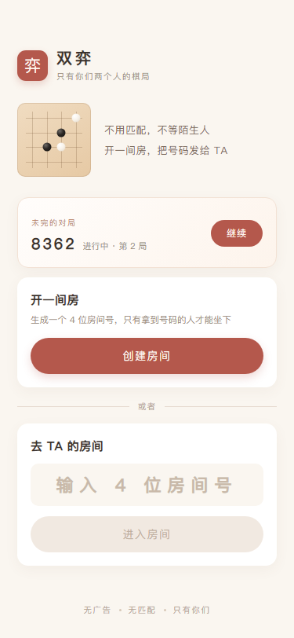
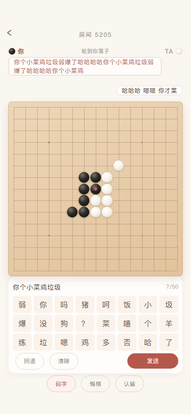
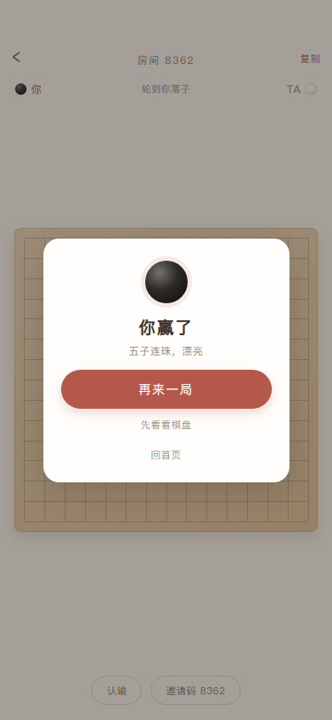

# 双弈 · 只有你们两个人的五子棋

一个房间制的双人五子棋小程序：没有匹配、没有广告、没有排行榜，只有两个人的棋盘。

| 首页 | 对局 | 结算 |
| --- | --- | --- |
|  |  |  |

> `design/` 里是按 WXSS 参数 1:1 还原的静态预览图，用于确认版式，不参与编译。

## 已实现

- 创建房间（4 位房间号，自动复用未结束的房间，不会堆一堆空房）
- 输入房间号 / 分享卡片进入，房主不用手动同意
- 15×15 标准棋盘，五子连珠判定、和棋判定、认输
- 双方同意后重开一局，并自动交换先后手；房间号不变，可以连着下一晚
- 悔棋：只能撤回自己刚下的一手，需要对方同意；请求后对方直接落子则请求自动作废
- 落子确认：点空位先出现半透明预览，底部换成「✕ 重选 / ✓ 落子」；换点直接移动预览，确认前不提交
- 码字：点「码字」在棋盘下方展开 24 字字盘，拼句发送；一句话最多 50 字
  - 字盘打开时棋盘位置不变，仍然可以正常落子
  - 双方各有一条独立消息位，各显示 3 秒，互不覆盖
  - 支持回退、清除；发送后面板不收起，点「码字」才收起
- 指路：长按任意空点，对方棋盘上闪一圈涟漪——只有暗示，不落子
- 一局结束后的 30 分钟内，房间还能从首页「刚刚那局」回去，不用重新开房
- 落子后实时同步（云数据库 `watch` 推送，失败自动降级为轮询）
- 断线重进 / 切后台回来可恢复对局
- 落子、轮次、胜负全部由云函数校验，前端只做展示

## 跑起来（6 步）

1. 用微信开发者工具「导入项目」，目录选本仓库根目录。
2. 把 `project.config.json` 里的 `appid` 换成你自己的小程序 AppID（不能用测试号，测试号没有云开发）。
3. 开通云开发：工具栏**左侧**点「云开发」，按提示开通，记下环境 ID。
   - 新版工具如果找不到入口，可直接登录 mp.weixin.qq.com 小程序后台 → 开发 → 云开发
   - 如果账号下只有一个环境，`miniprogram/app.js` 里的 `CLOUD_ENV` 留空即可。
   - 有多个环境时，把环境 ID 填进 `CLOUD_ENV`。
4. 数据库集合 `rooms` 会在首次运行时由云函数**自动创建**，不需要手动建表。
   - 想让对方落子秒同步：云开发控制台 → 数据库 → `rooms` → 权限设为「所有用户可读，仅创建者可写」
   - 不改也能玩：实时监听会失败并自动降级成 2.5 秒轮询，只是对方落子慢半拍
5. 右键 `cloudfunctions/gomoku` → **上传并部署：云端安装依赖**。
6. 编译运行。测试时建议用「多账号调试」或一台真机 + 一个模拟器：
   一方创建房间拿到 4 位号码，另一方输入号码进入。

## 目录

```
miniprogram/
  app.js                 云开发初始化 + 获取匿名身份
  utils/cloud.js         云函数调用封装、错误文案归一
  pages/index/           首页：创建 / 加入 / 继续对局
  pages/game/            对局页：棋盘、实时同步、结果弹层
cloudfunctions/gomoku/   唯一的云函数，action 分发
```

## 云函数动作

| action | 作用 | 关键防错 |
| --- | --- | --- |
| `whoami` | 返回当前用户在本产品内的匿名 uid | openid 经 SHA256 截断，不落库明文 |
| `create` | 建房 / 复用未结束房间 | 12 小时过期自动关闭 |
| `join` | 按房间号加入 | `where(playerCount=1)` 条件更新，杜绝两人同时挤进同一间房 |
| `get` | 恢复对局 | 支持 roomId 或 房间号 |
| `place` | 落子 | 校验轮次 + `moveCount` 乐观锁；不用 `version`，否则对方发消息也会把你的落子顶掉 |
| `rematch` | 再来一局 | 双方都同意才重置，交换先后手 |
| `requestUndo` | 请求悔棋 | 只有「刚下完、还没轮到对方」的人能发起；`version` 锁拒绝并发 |
| `respondUndo` | 同意 / 拒绝悔棋 | 同意时校验 `lastMove` 与棋谱末位一致，避免撤回错子 |
| `cancelUndo` | 撤回自己的悔棋请求 | 只有发起人可取消 |
| `sendSentence` | 发一句拼出来的话 | 只允许 24 字盘里的字 + 最多 50 字 + 1 秒冷却，按颜色写入各自消息位 |
| `sendHint` | 长按指路 | 只能指空点 + 1200ms 冷却，不改变棋局 |
| `resign` / `leave` | 认输 / 取消空房 | 只允许等待中的房间被关闭 |

## 数据（rooms 集合）

```js
{
  code: '8362',
  status: 'waiting' | 'playing' | 'finished' | 'closed',
  board: number[225],        // 0 空 / 1 黑 / 2 白，索引 = y * 15 + x
  history: [{ x, y, color }], // 棋谱，用于悔棋与后续复盘
  undoRequest: null | { by: uid, color, at },
  sentenceBlack: null | { text, by, at },  // 黑方当前这句，客户端只显示 3 秒内的
  sentenceWhite: null | { text, by, at },  // 白方独立一份，双方互不覆盖
  hint: null | { x, y, by: uid, color, at },   // 指路涟漪
  turn: 'black' | 'white',
  winner: 'black' | 'white' | 'draw',
  winLine: number[],         // 用于高亮连成五子的棋子
  players: [{ color: 'black' }, { color: 'white' }],
  playerIds: [uid],
  playerCount: 1,
  rematchIds: [uid],
  version: 0,                // 每次写入 +1，客户端据此去重
  round: 1,
  lastMove: { x, y, color },
  createdAt, updatedAt
}
```

## 刻意没做的

- 开放匹配、观战、聊天、排行榜：会引入陌生人，违背"只有你们"的前提。
- 一次撤两步的悔棋：会让"悔棋"变成"看穿对方应手后再改主意"，只保留撤回自己刚下的一手。
- AI 对手：和情侣对局的定位冲突，后续可作为"等人时自己练棋"的独立入口。
